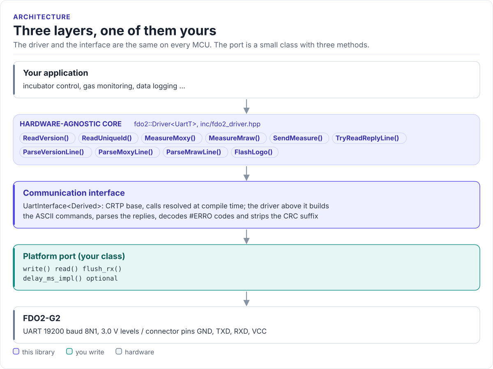

# FDO2 Driver

A C++17 driver for the PyroScience FDO2-G2 optical oxygen sensor: identify the module, measure oxygen partial
pressure and temperature, read raw optical, pressure and humidity data, from any MCU with a UART.

[](https://github.com/hardfoc/hf-fdo2-driver/actions/workflows/ci-host-tests.yml)
[](https://github.com/hardfoc/hf-fdo2-driver/actions/workflows/esp32-examples-build-ci.yml)
[](https://hardfoc.github.io/hf-fdo2-driver/)
[](LICENSE)

**Documentation: <https://hardfoc.github.io/hf-fdo2-driver/>**

<!-- figure: driver-layers -->
<picture>
  <source media="(prefers-color-scheme: dark)" srcset="docs/diagrams/driver-layers.dark.svg">
  
</picture>
<!-- /figure -->

## In 30 seconds

Write a small port class for your MCU (write bytes, return one reply line, flush;
[Porting](https://hardfoc.github.io/hf-fdo2-driver/latest/porting/)), then:

<!-- generated: quickstart-code -->
```cpp
#include "fdo2.hpp"
#include <cstdio>

int read_oxygen(MyUart& uart) {
  fdo2::Driver<MyUart> sensor(uart);
  uart.delay_ms(fdo2::kFdo2G2PowerUpSettleMs);          // 1. the module needs about 1 s after power-up

  const auto version = sensor.ReadVersion();            // 2. identify: D = 8 for an FDO2-G2
  if (!version || version.value.device_id != 8) {
    return -1;                                          // wiring, baud rate or supply
  }

  const auto m = sensor.MeasureMoxy();                  // 3. one measurement, up to 150 ms
  if (!m || !fdo2::MoxyStatusOkForOxygen(m.value.status_u32)) {
    return -2;                                          // timeout, #ERRO or a fault bit in S
  }
  std::printf("pO2 %.3f hPa at %.3f C\n", m.value.p_o2_hpa, m.value.temp_c);  // 4. use it
  return 0;
}
```
<!-- /generated -->

## What it does

- Sends the FDO2-G2's read-only commands: `#VERS`, `#IDNR`, `#MOXY`, `#MRAW`, `#LOGO`.
- Scales every field to engineering units (hPa, °C, mbar, mV, %RH) and computes volume percent O<sub>2</sub>.
- Returns a typed result for every call, decodes `#ERRO` codes and applies the datasheet's status rule.
- Measures blocking (`MeasureMoxy()`) or split (`SendMeasure()`, `TryReadReplyLine()`) for loops that serve other
  devices.
- No heap, no exceptions, no RTOS, no virtual calls (the port is a CRTP class), and no command that writes the
  module's flash.

## Install

```bash
git submodule add https://github.com/hardfoc/hf-fdo2-driver.git external/hf-fdo2-driver
```

```cmake
add_subdirectory(external/hf-fdo2-driver)
target_link_libraries(my_app PRIVATE hf::fdo2)
```

ESP-IDF: use the component wrapper in [`examples/esp32/components/hf_fdo2`](examples/esp32/components/hf_fdo2/CMakeLists.txt).
Details: [Installation](https://hardfoc.github.io/hf-fdo2-driver/latest/installation/).

## Documentation

| | |
| --- | --- |
| [Quickstart](https://hardfoc.github.io/hf-fdo2-driver/latest/quickstart/) | Wire it, write the port, read oxygen |
| [Hardware](https://hardfoc.github.io/hf-fdo2-driver/latest/hardware/) | Connector, UART settings, timing, power |
| [UART protocol](https://hardfoc.github.io/hf-fdo2-driver/latest/uart-protocol/) | Commands, fields, status bits, error codes |
| [API guide](https://hardfoc.github.io/hf-fdo2-driver/latest/api-guide/) | Identify, measure, raw data, errors |
| [Examples](https://hardfoc.github.io/hf-fdo2-driver/latest/examples/) | ESP32-S3 applications |
| [API reference](https://hardfoc.github.io/hf-fdo2-driver/latest/api/) | Doxygen, every class and member |

The pages are in [`docs/`](docs/index.md); the datasheet is in [`docs/datasheet/`](docs/datasheet/Datasheet_FDO2-G2.pdf).

## Tests

```bash
cmake -S . -B build-host -DHF_FDO2_BUILD_TESTS=ON && cmake --build build-host && ctest --test-dir build-host
```

The host tests run the driver against a model of the sensor; the code on the documentation site is compiled by
the same build.

## License

MIT. See [LICENSE](LICENSE).
