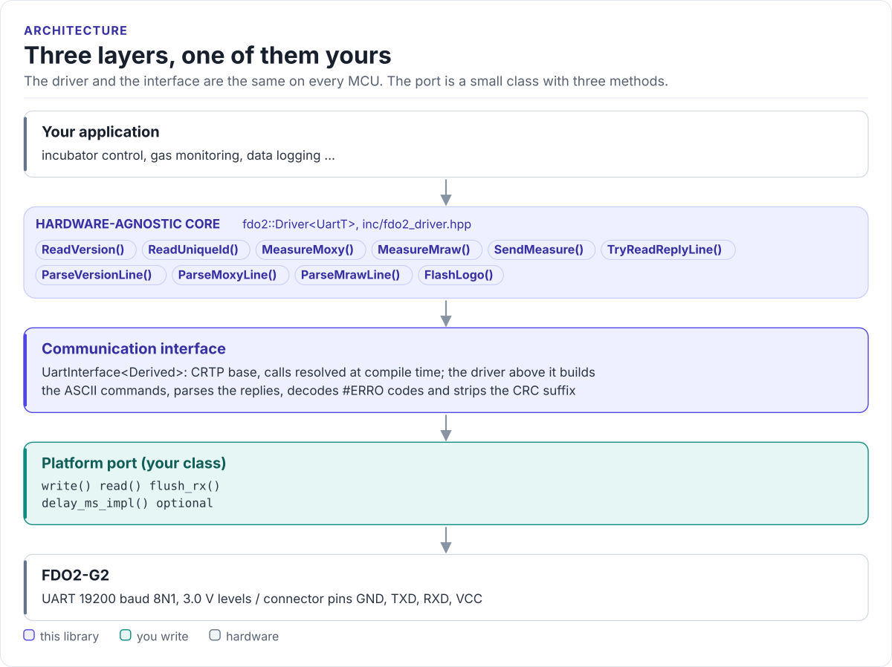
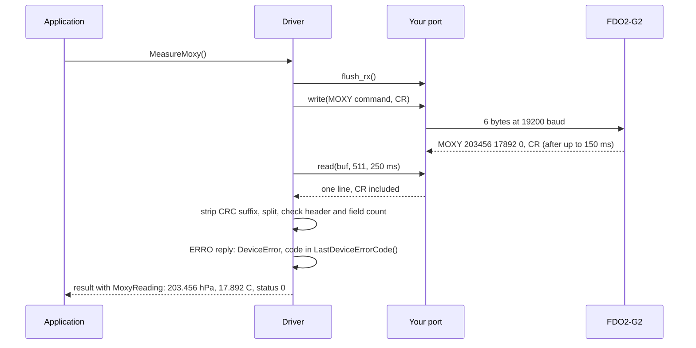

# Architecture

How the driver is put together: three layers, what each owns, and how one call reaches the sensor.

<!-- figure: driver-layers -->
<picture>
  <source media="(prefers-color-scheme: dark)" srcset="diagrams/driver-layers.dark.svg">
  
</picture>
<!-- /figure -->

## The three layers

| Layer | Where | You change it when |
| --- | --- | --- |
| **Hardware-agnostic core**: `fdo2::Driver<UartT>` | [`inc/fdo2_driver.hpp`](../inc/fdo2_driver.hpp), [`inc/fdo2_types.hpp`](../inc/fdo2_types.hpp) | Never, for a new board |
| **Communication interface**: `UartInterface<Derived>` | [`inc/fdo2_uart_interface.hpp`](../inc/fdo2_uart_interface.hpp) | Never |
| **Platform port**: your class, three methods | Your project | Once per MCU or board ([Porting](porting.md)) |

Everything above the port is the same on ESP32, STM32, a Linux host or the unit-test model. That is how the
[host tests](testing.md) run the real driver code without hardware.

## How one call reaches the sensor

## Why CRTP

The interface is a class template parameter, not a virtual base class. The compiler sees your port's methods
directly and inlines them; the driver has no vtable, allocates nothing and needs no RTTI. The cost is that the
driver type names the port: `fdo2::Driver<MyUart>`. Code that has to work with several port types takes the
driver as a template parameter too.

## Results instead of exceptions

Every command returns `DriverResult<T>`: a `value` and an `error` (`DriverError`). It converts to `bool`, so
`if (!m)` reads naturally, and `fdo2::ToString(error)` names the error for a log. An `#ERRO` reply from the module
becomes `DriverError::DeviceError`, with the module's own code kept in `LastDeviceErrorCode()` until the next
command.

The status word `S` is not an error to the driver: a measurement with fault bits set still returns
`DriverError::None`, because the module did answer. Checking `S` is your job, as the datasheet requires; the
[API guide](api-guide.md#handle-errors-and-status) shows how.

## Memory and timing

The driver allocates nothing. A call uses under 1 KB of stack: the largest buffer is a 512-byte receive buffer,
then the reply line and its tokens. A call blocks for at most the timeout you set, plus whatever your port's
`write()` takes.

## Source map

| Path | Contents |
| --- | --- |
| `inc/fdo2.hpp` | Umbrella header: everything below plus `GetDriverVersion()` |
| `inc/fdo2_driver.hpp` | `Driver<UartT>`: commands, parsing, the split exchange |
| `inc/fdo2_types.hpp` | `DriverResult`, `DriverError`, readings, scaling, status bits, `VolumePercentO2()` |
| `inc/fdo2_uart_interface.hpp` | `UartInterface<Derived>`, the CRTP base of your port |
| `inc/fdo2_version.h.in` | Version header template, filled in by CMake |
| `tests/` | Host unit tests and the compiled documentation snippets |
| `examples/esp32/` | ESP-IDF applications and the ESP-IDF port |
