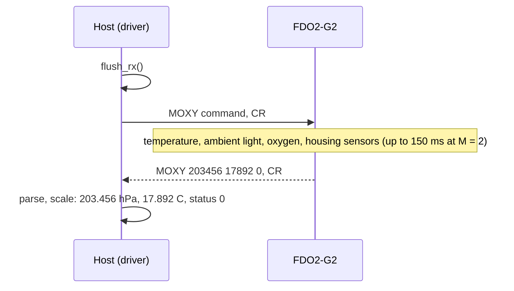

# Hardware

What to connect between your MCU and an FDO2-G2, with which UART settings, and the timing and power the module
needs.

All values here come from the [FDO2-G2 datasheet](datasheet/Datasheet_FDO2-G2.pdf) (document version v5, 03/2026):
specifications in section 2, the interface in section 4, the connector in section 7.

## Connector

The module has a Molex 560020-0420 socket (four positions) on its back, next to the venting capillary.
Directions are seen from the sensor.

| Pin | Name | Function |
| --- | --- | --- |
| 1 | GND | Ground |
| 2 | TXD | Output: UART transmit, 3.0 V levels |
| 3 | RXD | Input: UART receive, 3.0 V levels, 3.3 V tolerant |
| 4 | VCC | Supply, 3.3 V to 5.0 V DC |

Connect MCU TX to pin 3 and MCU RX to pin 2. There are no other control pins: no reset, enable or interrupt
line. The module is always on while VCC is present.

!!! warning "3.3 V maximum on RXD"
    The UART runs at 3.0 V and its absolute maximum is 3.3 V. A 3.3 V MCU can drive RXD directly; a 5 V MCU
    needs a level shifter or a divider on its TX line. The 3.0 V high level on TXD is above the input-high
    threshold of most 3.3 V MCUs; check yours.

## UART settings

| Setting | Value |
| --- | --- |
| Baud rate | 19200 after every power-up (`fdo2::kFdo2G2DefaultBaud`) |
| Frame | 8 data bits, no parity, 1 stop bit |
| Flow control | None |
| Command end | CR (`0x0D`), or CR LF |
| Reply end | CR only |
| Other rates | 1200 to 115200 with `#BAUD`, until the next power cycle; the driver does not send it |

The datasheet recommends 19200 for the highest reliability. At 19200 baud a `#MOXY` reply (about 25 characters)
takes about 13 ms on the wire.

## Timing

| Event | Time |
| --- | --- |
| Power-up to first command | about 1 s (`kFdo2G2PowerUpSettleMs` = 1100 ms) |
| Measurement, M = 0 to 2 (factory: 2) | up to about 150 ms |
| Measurement, M = 3 or 4 | up to about 300 ms |
| `#CALO` or `#CAHI` calibration | up to 10 s |
| Response time t63 | under 2 s |
| Warm-up to full accuracy | 3 min |

M is the flash duration mode set with `#SETM` (section 4.3); response time and warm-up are from section 2.

The module measures only when asked (unless broadcast mode is on), so the measurement time is part of every
`#MOXY` and `#MRAW` transaction:

The driver's default measurement timeout is 250 ms. Raise it with `SetMeasureTimeoutMs()` if the module is set to
M = 3 or 4 ([Configuration](configuration.md#timeouts)).

## Power

| Parameter | Value |
| --- | --- |
| Supply voltage | 3.3 V to 5.0 V DC |
| Absolute maximum supply | 5.5 V DC |
| Current, standby / peak | about 8 mA / 40 mA |
| Energy per measurement | about 1 to 2 mAs |

Do not interrupt the supply while the module writes its flash (after `#CALO`, `#CAHI`, `#CRCE`, `#SETM` or
`#BCST`): the datasheet warns that the flash can be corrupted. The driver sends none of these commands.

## Environment and mounting

| Parameter | Value |
| --- | --- |
| Operating temperature | −10 °C to 60 °C |
| Storage temperature | −40 °C to 60 °C |
| Internal pressure sensor range | 300 mbar to 1100 mbar |
| Maximum absolute / differential pressure | 20 bar / 3 bar |
| Humidity | back side non-condensing; no dew point inside the membrane |
| Mounting | M16 x 1 thread; Ø 28.5 mm x 28 mm; 10.5 g |

Keep direct sunlight and strong lamps off the sensing membrane: ambient light shows up in the status word and in
the `#MRAW` ambient-light field. The cross-sensitivity table (section 3) lists the gases that disturb or damage the
sensor, NO2 and Cl2 among them.

## Errata

| Erratum | Affects | Status |
| --- | --- | --- |
| Increased noise at two module-specific temperatures, typically between 8 °C and 15 °C, each about ±0.1 °C wide | Firmware 3.55 | Fixed in firmware 3.57 with a hardware change (PCN-FDO2-G2-001) |

`ReadVersion()` returns the firmware revision: `firmware_revision` 357 is 3.57.

## Evaluation

PyroScience sells the module with a USB adapter cable and the "Simple FDO2 Logger" software for Windows, which
installs a virtual COM port to the module's UART. It is a quick way to see the module answer before you wire it to
an MCU. The [ESP32 examples](examples.md) run on an ESP32-S3 with the module on UART1.

## Reference documents

| Document | What it is for |
| --- | --- |
| [FDO2-G2 datasheet](datasheet/Datasheet_FDO2-G2.pdf) | Specifications, the UART command set, error codes, connector, errata |
| [PyroScience FDO2-G2 product page](https://www.pyroscience.com/en/products/all-meters/fdo2-g2) | Accessories, newer datasheet revisions |
