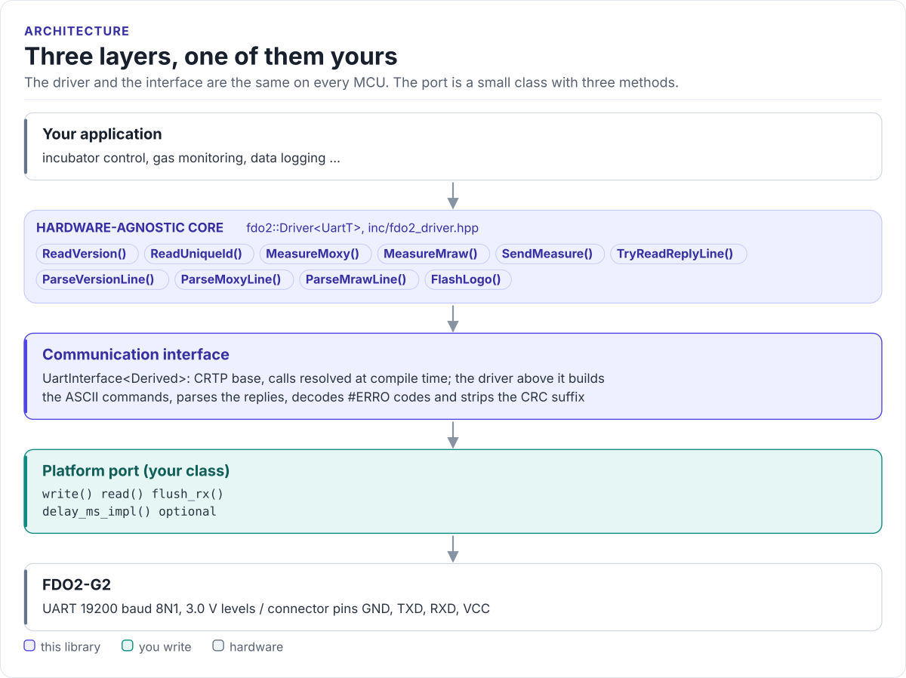

# Porting

Run the driver on a new MCU by writing one class: the UART interface.

The driver never calls your SDK directly. It calls three methods (and an optional fourth) on a class you derive
from `fdo2::UartInterface<Self>` (in [`inc/fdo2_uart_interface.hpp`](../inc/fdo2_uart_interface.hpp)). The base
class uses CRTP: the calls are resolved at compile time, so there are no virtual functions, no vtable and nothing
to allocate.

<!-- figure: driver-layers -->
<picture>
  <source media="(prefers-color-scheme: dark)" srcset="diagrams/driver-layers.dark.svg">
  
</picture>
<!-- /figure -->

## What you implement

| Method | Contract |
| --- | --- |
| `write(data, length)` | Send `length` bytes: one command, CR included. Return when they are queued or sent |
| `read(out, max, timeout_ms)` | Return one complete reply line, CR included, as a byte count; 0 if no whole line arrived within `timeout_ms`. With `timeout_ms` = 0, return only a line that is already complete |
| `flush_rx()` | Drop everything received so far, including a partial line |
| `delay_ms_impl(ms)` | Optional. Block for at least `ms`; `UartInterface::delay_ms()` calls it, and does nothing without it |

The driver calls `flush_rx()` and then `write()` at the start of every command, and `read()` once per reply.

## UART port

```cpp title="my_uart.hpp"
--8<-- "tests/docs/my_uart.hpp:port"
```

Rules the port must follow:

- **19200 baud, 8N1, no flow control.** That is the module's setting after every power-up.
- **Return at the CR.** The driver parses what one `read()` returns as the whole reply. A port that returns
  part of a line hands the driver a short reply (`ProtocolError`) and leaves the rest for the next command.
- **Return as soon as the line is complete.** A port that waits for `max` bytes or for the full timeout
  (a plain `uart_read_bytes(port, buf, max, timeout)` in ESP-IDF does this) still works, but every call then
  takes the whole timeout.
- **Keep a partial line on timeout.** The split exchange polls with `timeout_ms` = 0 while a reply is arriving;
  the port above keeps the bytes it has and returns the line on a later call.
- **Use a receive buffer of at least 128 bytes.** The longest reply, `#MRAW` with a CRC suffix, is under
  120 characters.

## Reference implementation

The ESP32 examples use [`hf_fdo2_esp_uart.hpp`](../examples/esp32/main/include/hf_fdo2_esp_uart.hpp): a template
`Fdo2EspIdfUart<port, tx_gpio, rx_gpio>` over the ESP-IDF UART driver, with a static `Install()` that configures
19200 baud 8N1 and the pins. Its `read()` follows the rules above: it reads one byte at a time with the time left
of the timeout, returns at the CR, and keeps a partial line for the next call. The host tests build it against a
model of the ESP-IDF UART calls (`tests/esp_idf_stub/`) and check that a command returns when the reply arrives.

## Check your port

1. Build it: the port on this page is compiled by the host CI from [`tests/docs/`](../tests/docs/my_uart.hpp),
   with the driver instantiated over it.
2. Wait 1 s after power-up and call `ReadVersion()`: device id 8 proves both directions and the baud rate.
3. Call `MeasureMoxy()` in air: about 210 hPa at sea level, status 0 or 1.
4. Time a `MeasureMoxy()` call: about 150 ms plus transfer time means the port returns at the CR; the full
   timeout means it waits for more bytes than the reply has.

## Threads

The driver is not thread-safe. Give each sensor one owner task, or guard every call on a driver object (and its
port) with one mutex. Several sensors on separate UARTs can run in parallel.
